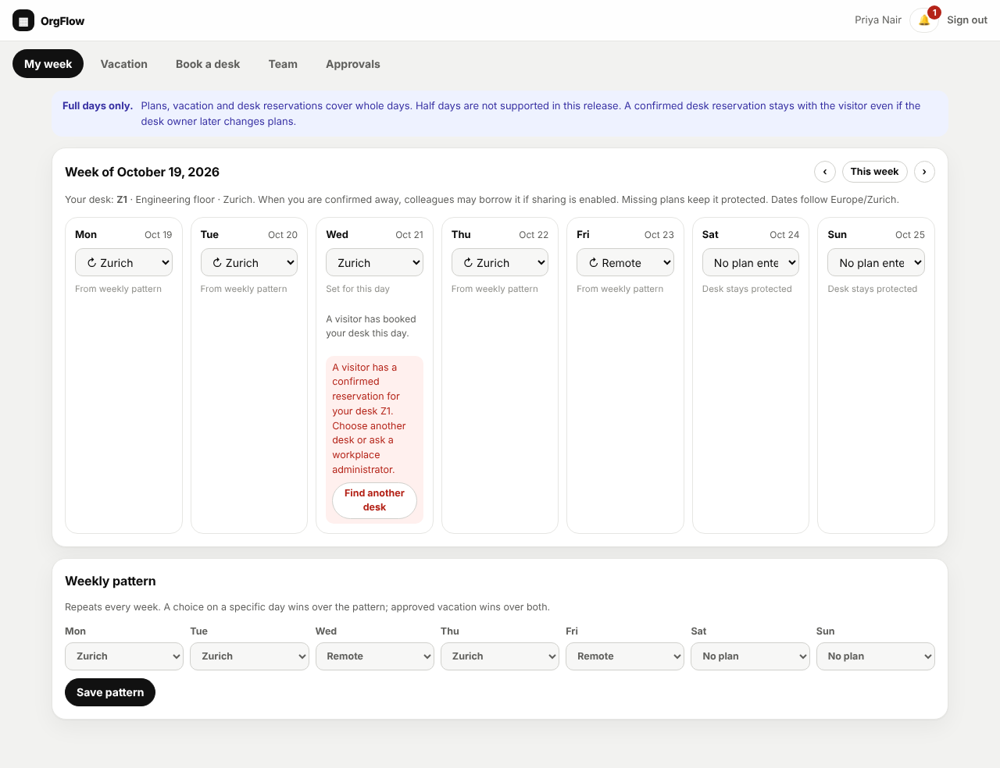
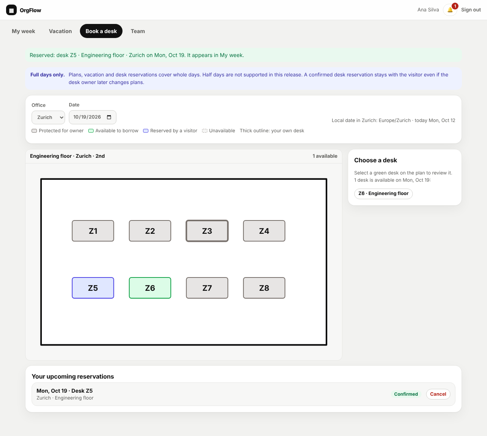
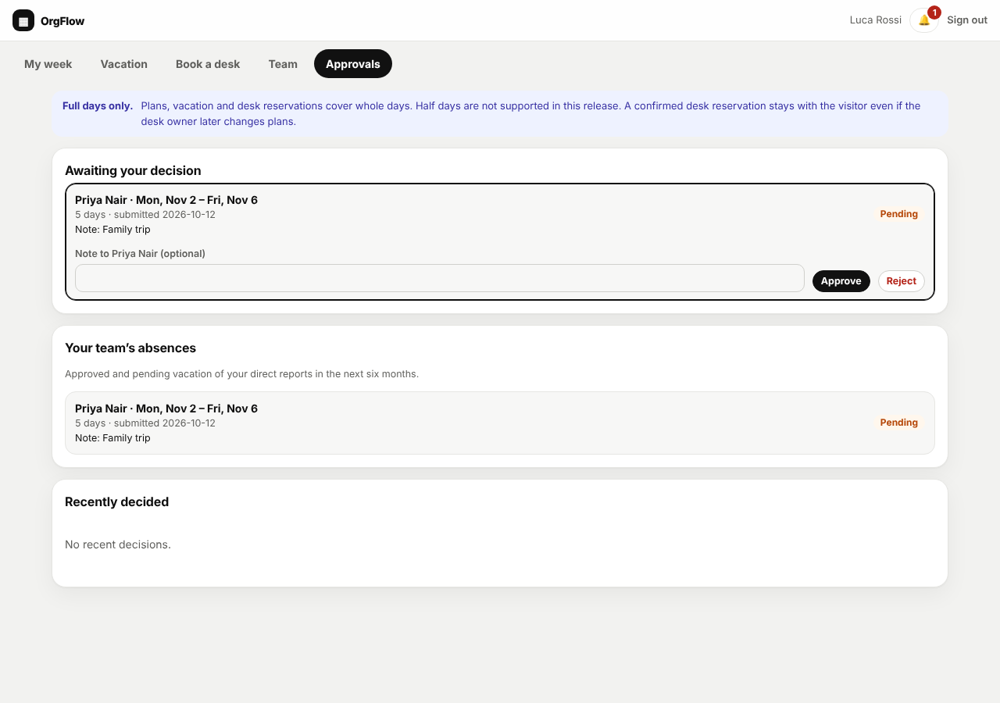
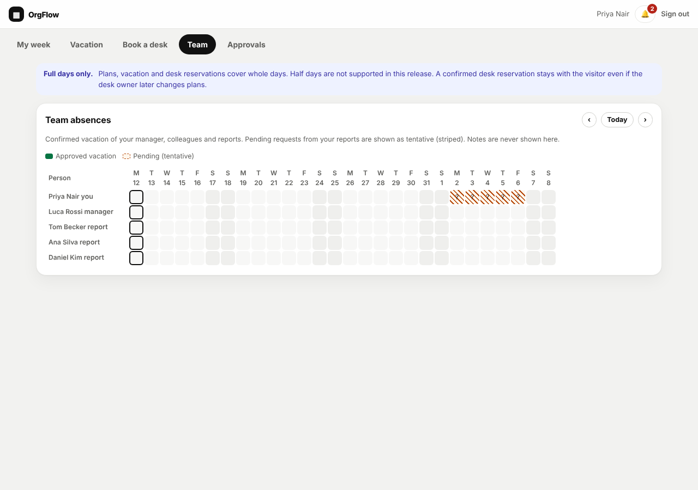
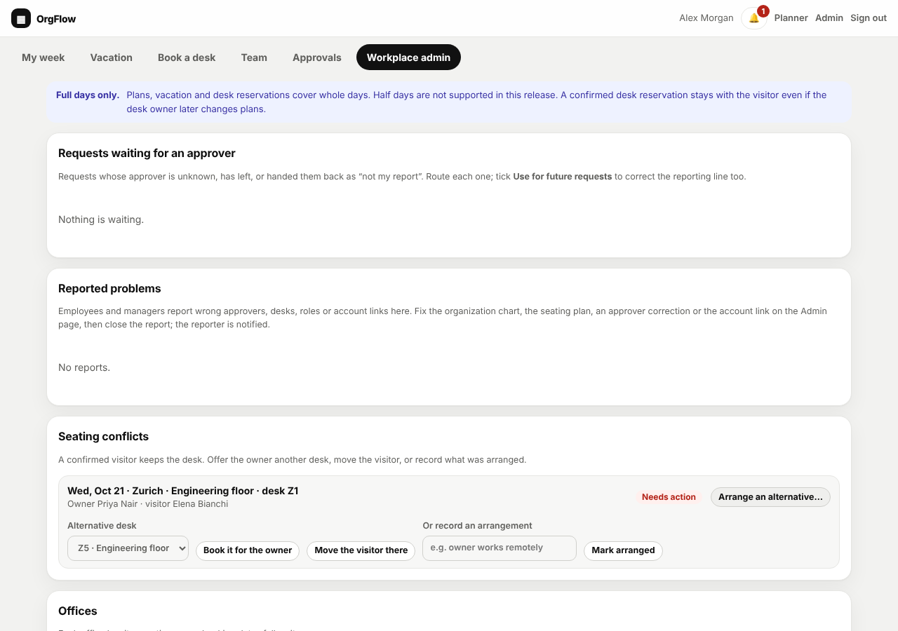
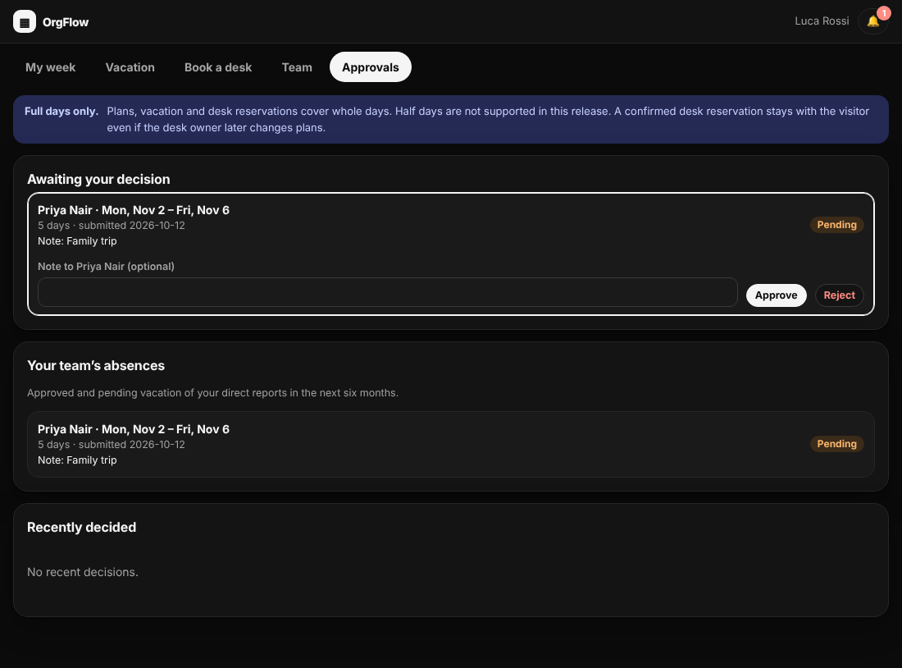
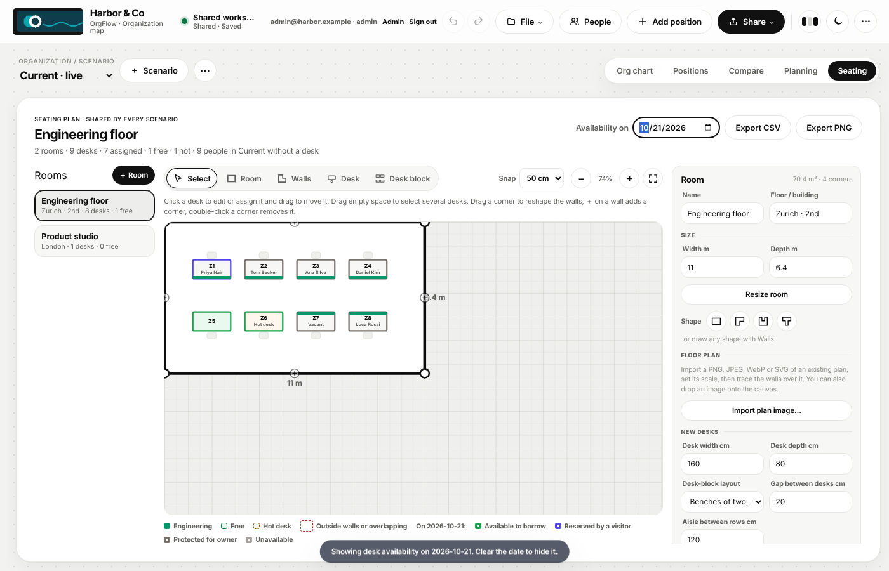
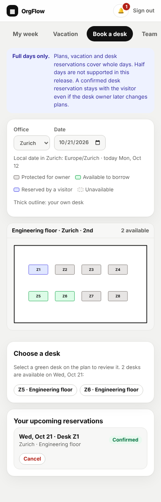

# Workplace planning: work locations, vacation and desk sharing

OrgFlow's shared enterprise host lets employees plan where they work, request vacation with manager approval, and borrow a colleague's desk in another office while its owner is confirmed away. Everyone keeps their assigned desk. A temporary reservation never changes the permanent seating plan.

The same screens open in a browser at `/workplace.html` and as the OrgFlow personal tab in Microsoft Teams (see [TEAMS.md](TEAMS.md)). The browser-only planner on GitHub Pages and the desktop app cannot coordinate company-wide bookings, so these features need the shared host.

> **First release: full days only.** Work locations, vacation requests and desk reservations always cover whole days. A confirmed desk reservation stays with the visitor even if the desk owner later changes plans. The interface shows this notice on every screen. Put the same statement in your company's workplace policy (wording below).

## Screens

| | |
| --- | --- |
|  |  |
| **My week**: plans, pattern, reservations and a seating conflict | **Book a desk**: availability on the room plan, confirmed by the server |
|  |  |
| **Approvals**: the manager's inbox and the team's absences | **Team**: confirmed and tentative absences |
|  |  |
| **Workplace admin**: arranging an alternative desk | **Teams tab** (dark theme), deep-linked to an approval |
|  |  |
| **Planner Seating view** with availability on a date | **Phone browser** fallback |

## What each person can do

| Role | How it is granted | Can |
| --- | --- | --- |
| Employee | Any member whose account is linked to an employee record in Current | Maintain their own work location and weekly pattern, request, change and cancel their own vacation, see permitted desk availability, book and cancel their own reservations, see the team absence calendar |
| Manager | Derived: the nearest filled position above a person in Current, or an administrator correction | Employee actions, plus the approval inbox for the people they are responsible for and their team's pending and approved absences |
| Workplace administrator | Every OrgFlow administrator, plus members with the **Workplace admin** tick on the Admin page | Manage offices and time zones, assign seating rooms to offices, enable desk sharing and describe equipment, close offices, rooms or desks, book and cancel on behalf of employees, resolve seating conflicts |
| OrgFlow administrator | `admin` role | Members, roles, employee links, approver corrections and configuration, plus everything a workplace administrator can do |

- The new **employee** role is scheduling-only. It never receives the organization chart, scenarios, the people directory or API tokens: `/api/workspace`, `/api/org/*` and MCP return 403. Opening the planner sends these accounts to the workplace screens. Admin, editor and viewer members can use the workplace screens too once their account is linked.
- Each account is linked to one stable employee ID in Current (for example `EMP-008`) on the Admin page. A record can be linked to only one account. Optionally, `WORKPLACE_LINK_BY_EMAIL=true` links a member automatically when exactly one employee in Current has an `email` field equal to the member's verified sign-in email. Leave it off if organization-chart editors should not be able to influence links by editing employee emails.
- Visitors browsing another office see desk availability, the room plan, equipment and notes. They do not see who owns a desk or why the owner is away.
- All rules are enforced by the server, whichever screen sends the request, including the Teams tab. Employees cannot approve their own vacation, and only the assigned approver can decide a request. OrgFlow administrators correct approvers; they do not approve on a manager's behalf.

## My week

Each day shows one of: a named office, **Remote**, or **No plan entered**, plus pending or approved vacation, any desk reservation (office, room and desk) and anything that needs attention.

- **Weekly pattern**: a location for each weekday, repeated every week.
- **A choice for a specific day wins over the pattern.** "No plan (skip pattern)" removes the pattern for one day.
- **Approved vacation wins over both.** A pending request is shown but changes nothing.
- **Missing information keeps the assigned desk protected.**
- **Working in another office counts as away** from the home office desk.
- Days in the past cannot be changed. "Today" follows the time zone of the employee's home office (the office of their assigned desk), or `WORKPLACE_TIMEZONE` when they have none.

## Vacation requests and approval

An employee chooses the first and last day, optionally adds a private note, and submits. The request records the employee, the assigned approver, the dates, the status, the submission and decision times, who decided, and an optional decision note. The approver gets a notification and sees the request in **Approvals** next to the team's approved absences.

| State | Calendar | Assigned desk |
| --- | --- | --- |
| Pending | Tentative for the employee and their manager | Stays protected |
| Approved | Confirmed absence | Can be borrowed if sharing is enabled |
| Rejected | Kept in the request history | Not released |
| Cancelled | Kept in the request history | Availability is recalculated |

- **New dates always need a fresh decision.** Changing a pending request re-submits it. Changing approved vacation creates a change request; the approved dates stay in force until the approver decides.
- A pending request can be withdrawn directly. **Cancelling approved vacation needs the approver**; the absence stays effective until then. Only one change or cancellation can wait per vacation.
- Overlapping or duplicate active requests are rejected.
- Colleagues (manager, people with the same manager, reports) see confirmed absence dates in **Team**. Private notes and decision notes are visible only to the requester, the approver and OrgFlow administrators.
- The approver is the nearest filled position above the employee in Current. When Current changes, or an administrator corrects an approver, pending requests move to the new approver and they are notified. Without any approver (for example the top of the organization), the employee is asked to have one assigned.
- Vacation balances, accrual and payroll are outside OrgFlow.

## Desk sharing

A workplace administrator first creates offices (name and IANA time zone, such as `Europe/Zurich`), then assigns each room of the seating plan to an office and enables sharing for single desks or whole rooms. Desks without sharing stay protected. Equipment can be described once a desk is shared; describing it never shares a desk by itself. A closure's room or desk must belong to its office.

For a shared, assigned desk on a given date:

| Owner's plan | Desk |
| --- | --- |
| Working in the desk's office | Protected for owner |
| Remote | Available to borrow |
| Working in another office | Available to borrow |
| Approved vacation | Available to borrow |
| Pending vacation, no other confirmed away plan | Protected |
| No plan | Protected |

- The owner is the person holding the desk's position in **Current** on that date (dated assignments apply). Proposed scenarios never change schedules, approvers or reservations.
- Unassigned desks are bookable only when sharing is enabled for them. A desk assigned to a vacant position is never released by the vacancy alone.
- Closures and confirmed reservations are taken into account. The planner's **Seating** view shows the same states for any date (**Availability on**), drawn over the permanent assignments.

## Visitor reservations

1. Open **Book a desk**, choose the destination office and the date.
2. Select a green desk on the plan (or from the list beside it).
3. Review its office, room, equipment and notes.
4. Choose **Reserve**. Success is shown only after the server has confirmed the booking.

The map distinguishes *Protected for owner*, *Available to borrow*, *Reserved by a visitor* and *Unavailable*. The reservation appears in **My week** with the office, room and desk, and the visitor's location for that day becomes the destination office.

- One desk per person per day, and one visitor per desk per day. The database enforces both: of two simultaneous requests for the same desk exactly one succeeds; the other gets "Someone else has just reserved this desk".
- Employees cancel their own reservations; cancelling asks them to confirm where they will work that day.
- Workplace administrators can book or cancel for an employee. The audit log records it and the employee is notified.
- Reservations can be made from today (in the office's time zone) up to `WORKPLACE_BOOKING_DAYS` ahead (default 90).

## When plans change after a booking

A confirmed visitor reservation does not disappear. If the owner switches back to working in that office, removes their away plan, or has approved vacation cancelled:

- the visitor keeps the desk;
- a **seating conflict** is shown in the owner's week and in Workplace admin;
- the owner and the workplace administrators are notified;
- the owner is offered the other available desks for that day, and booking one resolves the conflict;
- an administrator can instead move the visitor to another desk or record what was arranged; affected employees are notified.

Changes that would affect confirmed reservations are listed **before** they complete, and must be confirmed:

- a workspace save or scenario application that removes a booked desk, moves it to a room in another office, or changes who owns it on a booked date;
- moving a room to another office;
- closing an office, room or desk.

Removed or closed desks lose their reservations (status *displaced*); the visitors and workplace administrators are notified and the visitor is asked to choose another desk. An owner change keeps the reservation and raises a seating conflict if the new owner is not away. Turning sharing off keeps existing confirmed reservations and only stops new ones.

## Notifications

OrgFlow's own notification list (the bell) and the screens are authoritative. When the Teams bot is configured, the same notifications are sent to Teams as short messages that only say what happened and link to the authenticated screen; approval happens there, never in chat. Teams sends:

- new vacation requests and change or cancellation requests (to the approver);
- approvals and rejections (to the employee);
- booking confirmations and administrator changes;
- displaced reservations and seating conflicts (to the people affected and workplace administrators).

A failed or impossible Teams delivery never loses a request or invalidates a reservation. Deliveries are retried with backoff on network or server errors; an interrupted attempt is not repeated, so nobody receives the same message twice.

## Records, audit and retention

Work-location days, weekly patterns, vacation requests and their decisions, desk-sharing eligibility, closures, reservations, seating conflicts and notifications are separate tables beside the workspace document. Temporary reservations never write to the seating plan, and the workspace file format is unchanged: existing seating plans, workspace JSON files and `.orgflow` bundles open as before.

Every create, change, cancellation, approval, rejection, on-behalf booking, displacement and conflict resolution is written to the audit log (365 days) and to the record itself (who submitted, decided or cancelled, and when).

| Records | Kept for | Setting |
| --- | --- | --- |
| Work-location days, reservations, seating conflicts, closures | 400 days after their date | `WORKPLACE_SCHEDULE_RETENTION_DAYS` |
| Vacation requests and decisions | 3 years after the last vacation day | `WORKPLACE_VACATION_RETENTION_DAYS` |
| Notifications and delivery records | 180 days | `WORKPLACE_NOTIFICATION_RETENTION_DAYS` |

Weekly patterns, offices, sharing settings and approver corrections are kept until changed. Clean-up runs hourly with the existing retention job. `npm run backup` copies all of these with the workspace in one consistent snapshot; restore works as before.

## Suggested policy text

> Desk sharing at our offices works in whole days. You keep your assigned desk. On days you have told OrgFlow that you work remotely, in another office or are on approved vacation, colleagues may reserve it. If you have not entered a plan, your desk stays yours. Once a colleague's reservation is confirmed it stays valid even if your plans change; OrgFlow will flag the clash and help you find another desk. Vacation requests are approved by your manager in OrgFlow.

## Settings

| Variable | Default | Meaning |
| --- | --- | --- |
| `WORKPLACE_TIMEZONE` | `UTC` | Time zone for people without a home office |
| `WORKPLACE_BOOKING_DAYS` | `90` | How far ahead desks can be booked |
| `WORKPLACE_PLAN_DAYS` | `365` | How far ahead work locations can be entered |
| `WORKPLACE_LINK_BY_EMAIL` | off | Link members to the employee with the same `email` field in Current |
| `WORKPLACE_AUTO_ENROLL` | off | A verified sign-in (OIDC or Teams) whose email matches exactly one unlinked employee becomes a scheduling-only member |
| `WORKPLACE_*_RETENTION_DAYS` | see above | Retention |

## Not in the first release

Vacation balances, accrual, payroll and HR-system integration; half days; automatic release of unused bookings; occupancy sensors; external visitors; Outlook work-location sync; and Teams chat commands.

## Tests

`npm test` covers the rules and the acceptance criteria (`tests/workplace-core.test.cjs`, `tests/workplace-api.test.cjs`, `tests/teams.test.cjs`). `npm run test:workplace` drives the screens in Chromium against a seeded host, including the Teams tab with single sign-on and no cookies.
